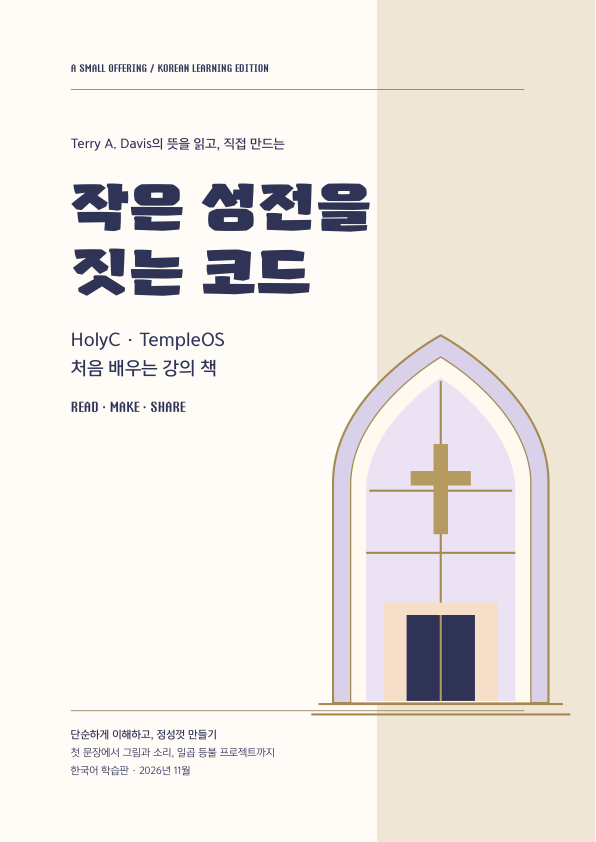
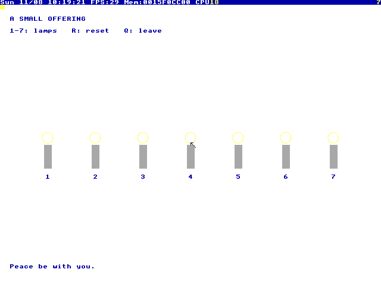

# 작은 성전을 짓는 코드

**HolyC와 TempleOS를 처음 만나는 사람을 위한 한국어 강의 책과 실행 가능한 보존 자료.**

테리 A. 데이비스가 남긴 단순함, 직접 만드는 즐거움, 공개된 소스, 신앙에 바친 창작이라는 뜻을 공부하고 실천합니다. 640×480·16색의 원래 TempleOS 안에서 한 줄의 출력부터 일곱 등불을 켜는 작은 프로그램까지 만듭니다. 그의 신앙은 본인의 기록에 근거해 다루며, 질병을 창작 능력의 원인으로 단정하지 않습니다.



## 바로 시작

- **[80쪽 A4 책 PDF 읽기](book/HOLYC_TEMPLEOS_A4.pdf)**
- **[전체 보존 ZIP 받기](https://github.com/catguard-team/holyc-templeos-book/releases/latest)** — 책·예제·편집 원본·실습 디스크·원본 ISO·소스를 한 번에 보관합니다.
- 내려받은 폴더의 **`book/index.html`**을 브라우저로 열면 인터넷 없이 읽을 수 있습니다.

Python 3.10 이상과 QEMU의 `qemu-system-x86_64`를 먼저 설치하세요. [운영체제별 설치·실행 안내](docs/PLATFORMS.md)에 macOS, Linux, Windows 절차가 있습니다. 필요한 프로그램을 설치한 뒤에는 실습에 네트워크가 필요하지 않습니다. GitHub의 Code → Download ZIP이나 `git clone`으로도 모든 자료를 받을 수 있습니다. Git LFS는 사용하지 않습니다.

| 호스트 | 폴더 안에서 실행 |
|---|---|
| macOS | `bash Start-mac.command` 또는 Finder에서 실행 |
| Linux | `bash start-linux.sh` |
| Windows | `Start-Windows.cmd` 더블클릭 |

첫 실행은 약 2 GiB의 쓰기 가능한 실습 디스크를 복원합니다. **부트 메뉴에서 `1` → Enter**를 누르면 `C:/Home/Book`이 열립니다. 영문 입력 상태에서 다음을 입력하세요. 끝의 세미콜론도 포함합니다.

```c
#include "HELLO.HC";
#include "GARDEN.HC";
```

정원에서는 `1`~`7`로 등불을 켜고, 소문자 `r`로 초기화하고, 소문자 `q`로 돌아옵니다. GUI 프로그램 중 일부는 다른 키를 누를 때까지 기다립니다. 이것은 멈춘 상태가 아닙니다.



## 책과 예제

6부·19강, 완전한 예제 24개·324행, 연습문제와 8주 학습안으로 구성했습니다. 자료형, 반복, 함수, 배열, 포인터, 메모리, 파일, 16색 그래픽, 키 입력, 소리, 작업 실행을 단계별로 다룹니다. 생애에 관한 이야기와 확인된 기술적 사실을 구분하며 28개 출처를 수록했습니다.

| 위치 | 내용 |
|---|---|
| `book/` | 조판 완료 PDF, 오프라인 HTML |
| `examples/` | 책에 실린 완전한 HolyC 예제 24개 |
| `editable/indesign/` | 실제 저장·재열기 검증한 INDD와 교환용 IDML |
| `manuscript/` | 편집 가능한 한국어 원고와 페이지 데이터 |
| `tools/` | 실행·복원·HTML 재생성·보존 검증 도구 |
| `runtime/` | 예제가 설치된 TempleOS 디스크의 압축 정본 |
| `archive/templeos/` | 변경하지 않은 원본 ISO와 고정 커밋 소스 |
| `archive/qemu/` | QEMU 11.1.3 원본 소스 분할본·서명·공개 키 |
| `assets/fonts/`, `licenses/` | HTML용 공개 글꼴과 제3자 이용허락 |
| `evidence/` | 내용·조판·실행·보존 검증 기록 |

## 저장하고 다시 실행하기

작업은 호스트의 `state/TempleOS.img`에 남습니다. 예를 들어 TempleOS에서 `Ed("MYWORK.HC");`로 작성하고 **Esc로 저장**한 후 QEMU를 닫으세요. 다음 실행은 같은 디스크를 사용하며 기존 파일을 새 정본으로 덮어쓰지 않습니다.

- 백업: QEMU를 닫은 뒤 `state/` 폴더 전체를 복사합니다.
- 새 실습장: `python3 tools/launch.py --state "새 실습장"` (Windows는 `py -3`).
- 원본 예제 수정: VM 안의 `C:/Home/Book`에서 편집합니다. 호스트의 `examples/`와 VM 파일은 자동 동기화되지 않습니다.
- 기본 실행은 음소거입니다. 소리 강의에는 `--sound`를 추가합니다. 호스트 오디오 환경에 따라 설정이 필요할 수 있습니다.

## 편집과 재생성

```sh
python3 tools/build_book.py
```

추가 pip 패키지 없이 원고에서 HTML을 다시 만듭니다. Windows에서는 `py -3 tools/build_book.py`를 사용합니다. 공개 글꼴도 함께 보관해 외부 웹폰트 서버에 의존하지 않습니다. 인쇄용 정본은 80쪽 PDF입니다. 브라우저 인쇄는 브라우저·설정에 따라 쪽수가 달라질 수 있습니다.

InDesign 원본은 macOS·Windows에서 편집할 수 있습니다. **Adobe InDesign은 Linux에서 네이티브 실행되지 않습니다.** Linux에서는 HTML·원고·코드 편집 경로를 사용하세요. 원본 윤디자인 서체의 폰트 프로그램은 배포하지 않으며, 해당 서체가 없으면 대체가 필요합니다. [편집 안내](docs/EDITING.md)를 참고하세요.

## 보존 범위와 검증

외부 링크만 모은 자료가 아닙니다. 원본 TempleOS ISO·전체 소스, 실습 디스크, QEMU 소스, 공개 글꼴과 HTML 생성 의존성을 실제 파일로 보관합니다. [보존 및 복구 안내](docs/ARCHIVE.md)에 해시 검사와 분할본 복원 방법을 기록했습니다. QEMU·Python의 각 운영체제용 설치 파일과 전체 빌드 도구체인까지 포함한 독립 운영체제 배포판은 아닙니다.

| 환경 | 확인 범위 |
|---|---|
| macOS / Apple Silicon / QEMU 11.1.3 TCG | 원본 TempleOS 부팅, 예제 24개, 그래픽·입력, 실습 디스크 재부팅·저장 유지 |
| Linux / ARM64 / Debian QEMU 7.2.22 TCG | 실습 디스크 부팅·예제 실행·저장 유지, HTML 재생성, 실행 도구 검사 |
| Windows | 전용 실행 파일과 경로·명령 구성 검사. **실제 Windows 호스트에서 부팅한 검증은 아직 없습니다.** |

실제 측정한 범위와 제한은 [검증 기록](evidence/README.md)에 공개합니다. QEMU는 x86-64를 소프트웨어로 에뮬레이션하므로 Apple Silicon에서도 같은 게스트 코드를 실행합니다. 호스트의 실제 디스크나 네트워크 장치는 게스트에 연결하지 않습니다. GitHub Actions와 유료 CI는 사용하지 않습니다.

## CC0와 원저자

**이 프로젝트에서 새로 작성한 책 본문·예제·디자인·도구는 [CC0 1.0](LICENSE)로 공개합니다.** 복사, 수정, 재배포, 상업적 이용이 가능하며 출처 표시를 의무로 요구하지 않습니다. 다만 원저자의 기록과 기여를 존중하는 표기는 권합니다.

이 선언은 제3자 자료의 권리를 바꾸지 않습니다. TempleOS는 원저자의 public-domain 공개 조건, QEMU는 GPL 등 해당 소스의 조건, 공개 글꼴은 SIL OFL, Python-Markdown은 BSD 조건을 따릅니다. 인용된 글·이미지·임베딩된 상용 서체에도 해당 권리가 남습니다. [제3자 고지](docs/THIRD_PARTY_NOTICES.md)에 범위를 구분했습니다.

TempleOS·HolyC의 창작자는 **Terry A. Davis (1969–2018)**입니다. [공식 보존 사이트](https://templeos.org/)와 [원본 소스 보존 저장소](https://github.com/cia-foundation/TempleOS)를 함께 안내합니다. 이 책은 독립적인 한국어 학습·보존 프로젝트이며, 유족이나 원본 보존 관리자의 공식 승인판을 뜻하지 않습니다.
